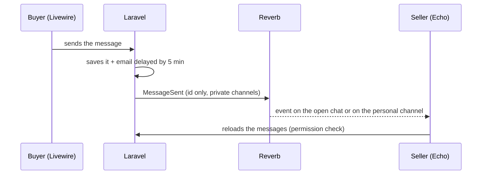
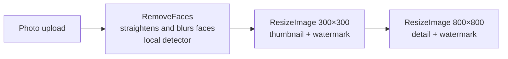
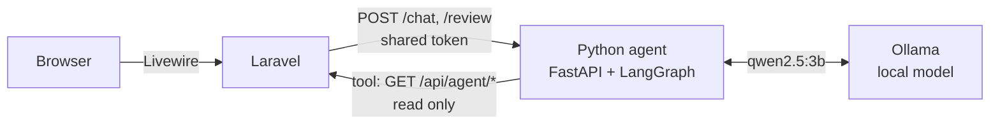

# Presto.it


[](https://github.com/DarioDidonna/presto-ai-marketplace/actions/workflows/tests.yml)

🇮🇹 **[Leggi in italiano](README.md)**

**A classifieds marketplace with human moderation and AI-assisted image processing.**

Every listing a user publishes goes through a moderator before it becomes visible. Uploaded photos are processed in the background: a **local** detector blurs faces and watermarked thumbnails are generated. For each photo the moderator sees how many faces were hidden and can ask the AI agent for an opinion.

An **AI agent** written in Python (LangChain/LangGraph) with a **local model** served by Ollama helps users find listings in natural language and gives moderators a reasoned opinion on each listing, with no API keys and working offline.

Final project of the Hackademy course (Aulab), then extended with refactoring, automated tests and new features. The interface is available in Italian, English and Spanish; the screenshots show the Italian version.

<p align="center">
  <br>
  <sub>The assistant answers with a real listing (local model on Ollama) and the listing is added to the cart from its card. Video sped up while waiting.</sub>
</p>

<table>
  <tr>
    <td width="50%"><br><sub><b>Fill in with AI</b>: listing draft from a photo, with a local vision model</sub></td>
    <td width="50%"><br><sub><b>Real-time messages</b> (Reverb) and seller review after the purchase</sub></td>
  </tr>
  <tr>
    <td width="50%"><br><sub><b>Moderator dashboard</b>: AI opinion, a person always decides</sub></td>
    <td width="50%"><br><sub><b>Search and filters</b>, reserved listings and cart</sub></td>
  </tr>
</table>


---

## Features

### Users
- Sign-up, login and **password reset by email** (Laravel Fortify)
- **Publishing listings** with up to 6 photos, preview and real-time validation (Livewire)
- **Editing and deleting** your own listings: after an edit the listing goes back to moderation
- **Personal profile**: account details, profile photo (cropped and stripped of EXIF metadata), name and password change, list of your listings with their moderation status
- **Search and filters** on the listings page: text (Laravel Scout + TNTSearch, tolerant to typos and partial words in the title), category, price range and sorting by relevance, date or price
- **Email with the moderation outcome** (accepted or rejected), queued and in the user's language
- Application to become a moderator

### Cart and purchase requests
- **Cart** with listings grouped by seller: items are added from the listing page or straight from the AI assistant's cards
- **Sending purchase requests**: one request per seller, with an optional message and an email to the seller. Payment is agreed between the parties, as on private classifieds sites
- Requested listings become **reserved** (nobody else can order them); accepted ones become **sold** and leave the catalogue; declined or cancelled ones become available again
- **My orders** (cancellable while the request is pending) and **Received requests** to accept or decline, with an email to the buyer
- Sent in a transaction with **row locks**: two buyers cannot reserve the same listing at the same moment (verified by a MySQL test with two connections)

### Seller reviews
- After an **accepted** sale the buyer rates the seller from 1 to 5 stars, with an optional comment: **only once**, also enforced by a unique index in the database
- **Public seller page**: average rating, reviews and listings for sale, with no email or personal data
- Average and number of reviews next to the seller on every listing page; email to the seller for each new review

### Real-time messages
- Every purchase request has its own **conversation** between buyer and seller, to agree on pick-up and payment
- Messages arrive **without reloading the page** (Laravel Reverb + Echo, private channels authorised with the same policy as the page)
- **Unread counters** in the menu and on the cards, updated live even while on other pages
- **Email only when needed**: sent after 5 minutes, only if the message is still unread, one per burst of messages
- If Reverb is down, messages are still saved and appear on page reload



### Moderators
- **Moderation dashboard** with a first-in-first-out queue and confirmation before accepting or rejecting
- **Undo the last decision** within 5 minutes: the email to the author is only sent when the window closes, and only if the decision still stands
- For each photo: **how many faces were blurred** (or whether they have not been checked yet)
- Promotion to moderator through a **time-limited signed link** emailed to the administrator

### Image processing (queues)

Every uploaded photo starts a chain of queued jobs:



**Local face blurring.** `RemoveFaces` straightens the photo according to its EXIF data (phone photos are often stored "sideways") and asks the Python service for faces; the service uses OpenCV's **YuNet**: a 230 KB model included in the repository, ~20 ms per photo, no GPU and no network. Measured with `ai-agent/evals/faces.py`: **24 faces out of 25** (a profile with sunglasses is missed) and a false face in **2 object photos out of 24** (the studs of a toy brick). No threshold separates the two cases, so privacy comes first (low threshold, boxes enlarged by 25%) and the moderator sees how many faces were blurred in each photo. If the service is down the job retries later; `php artisan app:analyze-images` re-queues the photos still to be checked.

### AI assistant (Python + Laravel)

- **Shopping assistant**: a chat on every page. "I'm looking for a road bike under 500 euros" → the agent uses the site's search and filters as *tools* and answers with **real listings**, shown as clickable cards from which the listing can be added to the cart. It knows whether a listing is already reserved. It remembers the conversation ("and how much is it?") and answers in Italian, English and Spanish.
- **Listing from a photo**: in the listing form, "Fill in with AI" looks at the first photo with a local vision model (`qwen2.5vl:3b`) and fills in title, description and category, only in empty fields and never the price. The model only says what it sees; the code writes the text, so it cannot contain invented prices, contacts or measurements. The suggested category is marked as to be checked.
- **Opinion for the moderator**: in the dashboard, "Ask for an opinion" returns *accept / reject / needs review* with reasons and flags (forbidden content, scams, personal contacts, unsuitable photos). It is only a suggestion: the moderator always decides.



- The browser never talks to the Python service, and the agent never accesses the database: it only reads **published** listings through internal, token-protected APIs.
- **Defences in code, not just in the prompt**: a 3B-parameter model is not reliable on its own. Tool arguments are validated and anchored to the user's message, prompt injection is blocked both in messages and in listings, prices and links in the answer are checked against the real data, and moderation rules override the model.
- **Evaluations with the real model** (`ai-agent/evals/`): shopping assistant from 6/10 to 29/30 over three runs, moderator opinion 8/8, photo draft with no invented data 8/8. Details in [`ai-agent/README.md`](ai-agent/README.md) (in Italian).

### Other
- Interface in **Italian, English and Spanish** (text, validation and emails)
- Consistent dark theme, responsive layout, attention to accessibility (screen-reader text, "skip to content" link, `aria-*`)
- Real statistics on the homepage (published listings, users online, latest listings)
- **Link previews** (Open Graph and Twitter Card): a listing pasted into WhatsApp, LinkedIn or Telegram shows photo, title and price

---

## Tech stack

| Area | Tools |
|---|---|
| Backend | PHP 8.4+, Laravel 13, Laravel Fortify, Laravel Scout + TNTSearch |
| Frontend | Blade, Livewire 4, Bootstrap 5.3, Bootstrap Icons, Vite (no CDN dependencies) |
| Real time | Laravel Reverb (WebSocket), Laravel Echo |
| Images | Local face detection (OpenCV YuNet), Spatie Image (GD) |
| AI agent | Python 3.12 (uv), FastAPI, LangChain + LangGraph, Ollama with `qwen2.5:3b` (text) and `qwen2.5vl:3b` (vision, optional), local |
| Data | MySQL, queues and sessions in the database |
| Running it | Docker Compose (site, queue, Reverb, MySQL, agent, optional Ollama) |
| Testing and quality | PHPUnit, pytest, Playwright (browser tests), coverage above 90% (CI gate), Larastan (PHPStan level 5), Laravel Pint, ruff, GitHub Actions |

---

## Quick start with Docker

All you need is [Docker](https://www.docker.com/products/docker-desktop/): no PHP, MySQL, Node or Python to install.

```bash
git clone https://github.com/DarioDidonna/presto-ai-marketplace.git
cd presto-ai-marketplace
docker compose up --build
```

On the first start (a few minutes for the build) the database and demo data are created, and the agent blurs the faces in the photos. The site runs at [http://localhost:8000](http://localhost:8000): log in with the [demo accounts](#demo-accounts).

Six services start: site, queue, Reverb (real-time messages), MySQL, the Python agent and, on request, Ollama. Ports are only open on this computer.

**The AI assistant and "Fill in with AI"** use a local model through Ollama. Two ways:

```bash
# Ollama already installed on the computer (recommended on a Mac: it uses the GPU)
OLLAMA_URL=http://host.docker.internal:11434 docker compose up --build

# Or Ollama in a container (CPU only): downloads qwen2.5:3b (~2 GB) on the first start
docker compose --profile ai up --build
```

Without Ollama everything else works, face blurring included.

| Command | What it does |
|---|---|
| `docker compose down` | Stops everything, data is kept |
| `docker compose down -v` | Stops everything and deletes database, photos and index (the next start begins again from the demo data) |
| `docker compose logs -f app queue` | Site and queue logs |

The Docker environment is for trying the project locally (demo data, `APP_ENV=local`); it is not meant for production. Every pull request also builds and starts it on GitHub Actions.

## Manual installation

**Requirements:** PHP 8.4+ with the GD extension, Composer, Node.js 20.19+ (or 22.12+), MySQL.

```bash
git clone git@github.com:DarioDidonna/presto-ai-marketplace.git
cd presto-ai-marketplace

composer install
npm install

cp .env.example .env
php artisan key:generate
```

Set up the database in `.env` (`DB_DATABASE`, `DB_USERNAME`, `DB_PASSWORD`), then:

```bash
php artisan migrate --seed      # locally this also creates demo users and listings
php artisan storage:link
```

Start the application (server, queue, logs, Vite, Reverb for real-time messages and the AI agent together):

```bash
composer run dev
```

The site runs at [http://localhost:8000](http://localhost:8000).

### Demo accounts

| Role | Email | Password |
|---|---|---|
| User | `demo@presto.it` | `password` |
| Moderator | `revisore@presto.it` | `password` |

The demo data includes 24 listings in every state (published, in moderation, rejected) and, for the demo user, a ready cart, purchase requests in every state (one received to accept or decline, a completed sale, and accepted, declined and pending orders), conversations with unread messages, a received review and a purchase still to be reviewed.

To see real-time messages, open two browsers (or a private window): `demo@presto.it` and `giulia.romano@presto.it`, password `password`.

To bring the site back to the initial demo state (database, uploaded photos and search index from scratch) there is a single command; it asks for confirmation and does not run in production:

```bash
composer run demo
```

The site uses no CDN: icons and styles are part of the build, so the demo also works offline, face blurring and AI models included: no external services.

To use real photos instead of the generated images, see [`database/seeders/demo-images`](database/seeders/demo-images/README.md).

### AI assistant (optional)

Without the agent the site works normally: the chat and the moderator opinion simply do not appear, and faces in new photos stay marked as "not checked" until the agent is started (then `php artisan app:analyze-images`).

1. Install [Ollama](https://ollama.com) and download the model: `ollama pull qwen2.5:3b` (~2 GB; chosen because it runs well even with 8 GB of RAM).
2. Install [uv](https://docs.astral.sh/uv/): `brew install uv` (it installs Python 3.12 and the dependencies by itself).
3. Configure the token shared by Laravel and the agent and check the environment:
   ```bash
   php artisan app:ai-setup
   ```
4. `composer run dev` also starts the agent (http://127.0.0.1:8001). If `uv` or Ollama are missing it says so, without stopping the site.

### Email

In development, emails (password reset, moderator applications) go to the log (`MAIL_MAILER=log`). To see them rendered you can use a service such as Mailtrap by setting the `MAIL_*` variables.

---

### Deploying to production

Start from `.env.production.example` (copy it to `.env` on the server and fill in the empty values):

- `APP_URL` must be the real domain with `https://`: requests with another host are rejected and email links use this address;
- `ADMIN_EMAIL` receives the requests to become a moderator: the link must be confirmed with a click, lasts 3 days and works once;
- sign-up sends a confirmation email: without a working `MAIL_MAILER` nobody can publish or buy. Locally, with `MAIL_MAILER=log`, the link is in `storage/logs/laravel.log`;
- all emails go through the queue, one at a time (`MAIL_SECONDS_BETWEEN_SENDS`), and after 4 mail-server errors they end up among the failed jobs (`php artisan queue:retry all` to resend them): `php artisan queue:work` must keep running on the server;
- after updating: `php artisan migrate` and `php artisan app:strip-image-metadata`, which removes metadata (GPS included) from photos uploaded earlier.

## Useful commands

| Command | Description |
|---|---|
| `php artisan test` | Runs the test suite |
| `npm run test:browser` | Browser tests (Playwright): assistant chat and real-time messages |
| `composer run demo` | Brings the site back to the demo state (deletes the local database) |
| `php artisan app:ai-setup` | Configures the AI agent token and checks uv, Ollama and the model |
| `cd ai-agent && uv run python evals/shopping.py` | Evaluates the shopping assistant with the real model (also `evals/review.py`) |
| `php artisan app:make-user-revisor {email}` | Makes a user a moderator |
| `php artisan app:analyze-images [--all]` | Re-queues image analysis (only images never analysed, or all) |
| `php artisan scout:import "App\Models\Article"` | Rebuilds the search index |
| `php artisan queue:work` | Starts the queue worker (already part of `composer run dev`) |
| `php artisan reverb:start` | Starts the WebSocket server for messages on port 8080 (already part of `composer run dev`) |

---

## Testing

```bash
php artisan test
```

The Laravel tests cover, among other things:

- **security and permissions**: only moderators approve, promotion links are signed and expire, unpublished listings are invisible to other users, editing and deleting are reserved to the author, every route of the site is protected (login, moderator or signed link) or declared public in an explicit list, old addresses are redirected with a 301;
- **complete flows**: search and filters, publishing, moderation with email to the author and undo, password reset, profile and profile photo, the image processing chain, face blurring (boxes, retries while the service is down, all 8 EXIF orientations);
- **reviews**: only the buyer of an accepted sale, and only once, validation errors under the right form, correctly computed average, public page without private data;
- **messages**: only buyer and seller can read and write, conversation closed after a decline or cancellation, event broadcast on the right channels without the text, unread counters, delayed email skipped if the message was read;
- **cart and purchase requests**: no own, reserved or sold listings in the cart, one request per seller, two simultaneous purchases of the same listing (the second waits for the lock and finds the listing reserved), accept/decline/cancel only by whoever is entitled to and only while pending, emails to both parties;
- **error pages** 403, 404, 419, 429, 500 and 503 in the user's language;
- **SEO and sharing**: Open Graph meta tags per page, listing photo and price;
- **AI assistant**: internal APIs protected by a token and without personal data, chat and moderator opinion with a simulated agent (cards only for published listings, agent down, usage limits);
- **quality**: query limit per page (against N+1 problems), balanced HTML, no undefined CSS classes, no dead links, translated text.

The tests use an in-memory SQLite database and Scout's `collection` driver: they do not touch the development database or search index. In CI they also run on **MySQL 8.4**, the project's real database: that is where the row lock is verified (SQLite has none), and on MySQL no test may be skipped.

The Python agent has its own suite (`cd ai-agent && uv run pytest`) with a fake model and a fake Laravel: tools, prompt-injection defences, conversation memory, moderation rules, endpoints and authentication.

**Browser tests.** The JavaScript parts, which PHPUnit cannot run, are tested with [Playwright](https://playwright.dev) in a real browser: the assistant chat answers with listing cards and a card is added to the cart, updating the counter without reloading the page; a message reaches the other person in real time (two browsers, real Reverb) and, if they are on another page, the unread counter goes up. Playwright starts the site, Reverb and a fake AI agent (same API as the real one, without Ollama) on a separate database and `storage` folder: the development database is not touched. Command: `npm run test:browser`, with `composer run dev` stopped (they use the same ports). It also runs in CI.

**Coverage.** CI measures the coverage of both suites (PCOV in the MySQL job, `pytest-cov` for the agent), shows the percentage in each run's summary and fails if line coverage drops below **90%**. Locally: `cd ai-agent && uv run pytest --cov=presto_ai_agent`; for PHP you need PCOV or Xdebug (`php artisan test --coverage`).

**CI.** On every pull request and every push to `main`, [GitHub Actions](.github/workflows/tests.yml) runs:
- PHPUnit on SQLite and on MySQL, with the front-end build, and the Python agent's tests;
- the browser tests with Playwright;
- static analysis with [Larastan](https://github.com/larastan/larastan) and code style with [Laravel Pint](https://laravel.com/docs/pint) and [ruff](https://docs.astral.sh/ruff/);
- a check for known vulnerabilities in the dependencies (Composer, npm, Python). An advisory without a fixed version can get a justified, expiring exception in [`.github/npm-audit-exceptions.json`](.github/npm-audit-exceptions.json);
- the Docker environment, checking that the site responds and that the agent checks the faces in the demo photos.

**Dependabot** opens pull requests for security fixes on its own and, every week, for regular updates. Locally: `composer analyse`, `vendor/bin/pint` and `cd ai-agent && uv run ruff format .`.

**Static analysis.** Larastan (PHPStan for Laravel) at level 5, configured in [`phpstan.neon`](phpstan.neon), on `app`, `routes` and `database`: zero errors, with no baseline and no suppressions. Introducing it required declaring the types of the Eloquent relations (`BelongsTo<User, $this>`) and it found a real bug: the price was a **single-precision** `float` (`float('price', 8, 2)`, where since Laravel 11 the third argument is ignored), so €999,999.99, the maximum the form allows, was stored as €1,000,000. It is now `decimal(10,2)`, with a test.

---

## Code structure

```
app/
├── Console/Commands/        app:make-user-revisor, app:analyze-images, app:demo-reset, app:ai-setup
├── Events/                  MessageSent (broadcast with Reverb)
├── Http/Controllers/        Article, Public, Revisor, Profile, Cart, PurchaseRequest, Sales, Conversation,
│                            Review, Seller
│                            (+ Api/AgentController for the agent)
├── Http/Requests/           UpdateAvatarRequest, StoreReviewRequest (Form Requests)
├── Jobs/                    RemoveFaces (faces, local service), ResizeImage (watermarked thumbnails)
├── Livewire/                CreateArticleForm, EditArticleForm (+ Forms/ArticleForm, Concerns/HandlesArticleForm),
│                            ShoppingAssistant (chat), ReviewAssistant (AI opinion), Conversation (messages)
├── Models/                  Article, Category, Image, User, PurchaseRequest, PurchaseRequestItem, Message, Review
├── Notifications/           ArticleReviewed, PurchaseRequested, PurchaseRequestAnswered, PurchaseRequestCancelled, NewMessage,
│                            ReviewReceived
├── Policies/                ArticlePolicy (view, update, delete, add to cart), PurchaseRequestPolicy
├── Services/                AiAgentClient (Python service), Checkout and PurchaseRequestWorkflow (purchase requests)
├── Support/                 ArticleFilters (search and filters for the listings page)
└── View/Composers/          Homepage statistics
resources/views/             Blade pages and components (layout, card, avatar, navbar…)
lang/{it,en,es}/             Interface and validation translations
routes/api.php               Internal APIs for the agent (/api/agent/*)
routes/channels.php          Reverb private channels (conversations, user)
tests/Feature/               Feature tests (PHPUnit)
tests/Unit/                  Unit tests
tests/Browser/               Browser tests (Playwright) and fake AI agent
docker/                      Container start-up (APP_KEY, migrations, demo data) for compose.yaml
ai-agent/                    Python service for the AI agent
├── src/presto_ai_agent/     app (FastAPI), agent (LangGraph), tools, guardrails, review, laravel_client
├── tests/                   pytest with a fake model and a fake Laravel
└── evals/                   evaluations with the real model
```

The code comments and the commit history are in Italian.

---

## Author

**Dario Didonna** — [GitHub](https://github.com/DarioDidonna)

## Licence

Code released under the [MIT](LICENSE) licence. Exceptions, each with its own licence:
- the demo photos in `database/seeders/demo-images/` (Wikimedia Commons: authors and licences in [`CREDITS.md`](database/seeders/demo-images/CREDITS.md));
- the YuNet model in `ai-agent/src/presto_ai_agent/models/` (MIT, [`LICENSE-yunet`](ai-agent/src/presto_ai_agent/models/LICENSE-yunet)).
